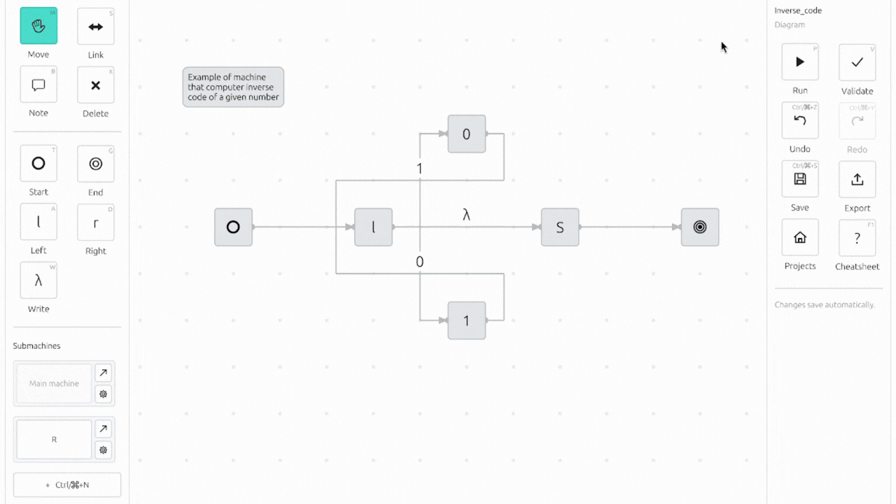
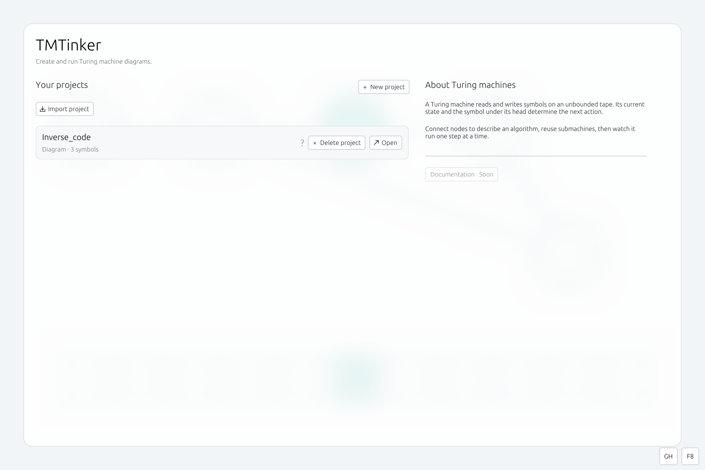
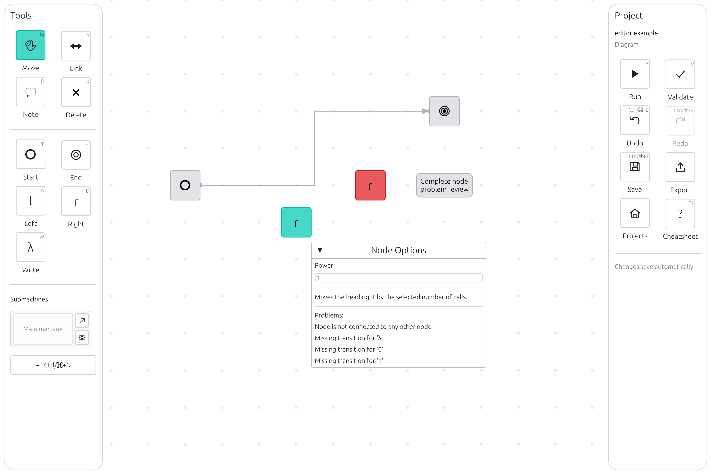

# Turing Machine Tinker

Build Turing machine diagrams and watch them run on a tape. TMTinker is an editor and simulator for studying algorithms and teaching computer science, built with Rust and egui.

**[Try it in your browser](https://tmtinker.pages.dev/)** *UNSTABLE AND NOT FULLY IMPLEMENTED*



## Features

- Draw machines with start, stop, move and write nodes. Connect them with transitions for the symbols in your alphabet.
- Reuse submachines and add notes to explain your diagrams.
- Run a machine, pause it or advance one step at a time. Adjust the step interval and follow the active node and tape head.
- Edit the tape as text or change individual cells and the head position.
- Save up to six tests per project with initial and expected tapes. Run them with a step limit and compare results relative to the head.
- Manage projects in a library, undo and redo edits, and import or export projects as JSON.

## Screenshots





## Your first machine

1. Open the app, choose **New project**, and enter a name and alphabet. You get the blank symbol `λ` as part of the alphabet.
2. Place nodes on the canvas. Choose **Link**, then click the source and target nodes. Select the transition to edit its symbols.
3. Choose **Validate** to check the diagram, then **Run diagram** to open the runner.
4. Enter a tape and choose **Apply tape**. Use parentheses to mark the head cell: `01(1)0`. For an empty tape, use `(λ)`.
5. Choose **Run** to start or **Step** to advance one step. Add initial and expected tapes to the test slots, then choose **Check all six** to run your saved tests.

Press **F1** or click **?** in the editor or runner for keyboard shortcuts and mouse controls. Use **Export project** to keep a JSON copy of your work.

## Run from source

You need Rust 1.88 or newer.

```bash
git clone https://github.com/nh4tco4/TMTinker.git
cd TMTinker
cargo run --release
```

Windows, trunk and macOS builds may be unstable.

To serve the web version on your machine, install Trunk and the WebAssembly target:

```bash
rustup target add wasm32-unknown-unknown
cargo install trunk --locked
trunk serve --open
```

## Roadmap

The current priority is to stabilize the editor and runner. The target for these additions and improvements is the end of November 2026:

- Built-in machines: copy a word, move one word left and move one word right.
- TU4 support and conversion between TU4 and diagrams.
- A Russian interface.
- PDF, SVG and PNG export.
- Improved Windows, macOS and web support.

## Contributing

Open an issue with steps to reproduce a bug or a description of the feature you need. For code changes, include what you changed and how you checked it in your pull request.

Run `./check.sh` for the repository checks. You need Trunk and the `wasm32-unknown-unknown` target for the web checks.
